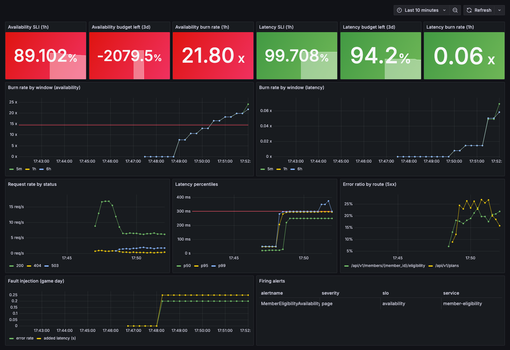

# slo-guardian


A small project I built to practice SRE basics: monitoring a service with SLOs and error budgets,
alerting on burn rate, and testing what happens when things break.

The service is a fake "member eligibility" API (like something a health insurance platform would have).
All data is made up.



*Dashboard during a chaos test with 20% of requests failing. The availability SLO is burning budget
~14x too fast, which triggers a page. Latency stays fine.*

## What it does

- **API** (`app/main.py`) - FastAPI app that exposes Prometheus metrics: request count by status and a
  latency histogram. Metrics use the route template instead of the real URL so member IDs never
  end up in metrics.
- **SLOs**
  - Availability: 99.5% of requests don't return 5xx
  - Latency: 95% of requests are faster than 300ms
- **Alerts** (`monitoring/rules.yml`) - multi-window burn rate alerts from the Google SRE Workbook.
  It pages if the budget burns 14.4x too fast over 1 hour (and is still happening in the last 5 minutes),
  or 6x too fast over 6 hours (and still in the last 30 minutes).
  A slower burn (3x over 1 day, still happening in the last 2 hours) opens a ticket instead of paging,
  for both availability and latency.
  The alerts have unit tests in `monitoring/rules_test.yml`.
- **Error budget report** (`slo_report.py`) - shows how much budget is left. Exits with code 1 when the
  budget is used up, so it can block a deploy in a pipeline.
- **Chaos testing** - `PUT /chaos` makes the API fail or slow down on purpose (only when `CHAOS_ENABLED=true`).
- **Kubernetes** (`k8s/`) - deployment with probes, resource limits and zero-downtime rolling updates,
  a PodDisruptionBudget so node drains never take down more than one pod at a time, and an HPA that
  scales from 3 to 10 pods on CPU.
- **CI** - GitHub Actions runs the tests, the alert rule tests, validates the k8s manifests and builds the image.
- **Runbook** (`docs/runbook.md`) - what to do when each alert fires.

## Run it

You need Docker.

```bash
make up
```

- API: http://localhost:8000/docs
- Grafana: http://localhost:3000
- Prometheus alerts: http://localhost:9090/alerts

A load generator starts with it, so the dashboard fills up after a minute or two.

## Break it

```bash
make chaos-on     # 20% errors + 250ms extra latency
```

After about 4 minutes the `AvailabilityBudgetBurn` alert fires and the report shows the budget is gone:

```
$ python slo_report.py --window 5m
SLO             TARGET       SLI    BURN  BUDGET LEFT
availability     99.5%   92.586%   14.8x       -1383%
latency          95.0%   98.687%    0.3x          74%

Error budget used up - don't deploy new features, fix reliability first.
```

```bash
make chaos-off
```

## Run on Kubernetes

```bash
docker build -t slo-guardian .
kubectl apply -f k8s/
```

On EKS you would push the image to ECR and change the image name in `k8s/deployment.yaml`.
The HPA needs metrics-server in the cluster (`kubectl top pods` should work).

## Tests

```bash
pip install -r requirements.txt pytest httpx
python -m pytest
make test-rules   # alert rule tests with promtool (needs Docker)
```

## New Relic

Everything is plain Prometheus. To send the metrics to New Relic, uncomment the `remote_write`
section in `monitoring/prometheus.yml` and add a license key.

## What I'd add next

- Alertmanager to route alerts to Slack / PagerDuty
- Helm chart or ArgoCD for deployments
