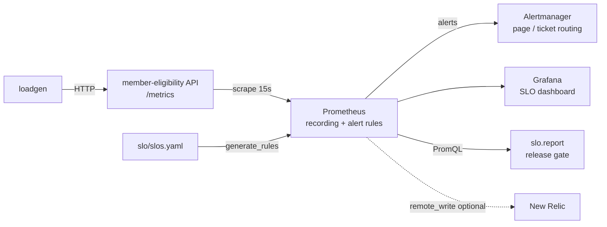

# slo-guardian

[](https://github.com/mirzaak/slo-guardian/actions/workflows/ci.yml)

**SLO-driven reliability for a healthcare-style microservice** - SLIs, SLOs and error budgets defined as code,
multi-window burn-rate alerting, a release gate, game-day fault injection, Kubernetes manifests hardened for EKS,
and the runbooks + incident process that make alerts actionable.

The service is a synthetic *Member Eligibility API* (no real data, no PHI). The point isn't the API - it's
everything around it that keeps it reliable.


*Game day: 20% injected errors. Availability burns at ~22x and pages on-call; latency stays within budget.*

## What's inside

| Area | What it shows | Where |
|---|---|---|
| **Instrumentation** | RED metrics (rate, errors, duration) labelled by route *template* to bound cardinality; probe traffic excluded from SLIs; JSON logs with pseudonymised member refs (no identifiers in logs or metrics) | [`app/main.py`](app/main.py) |
| **SLOs as code** | One YAML file defines availability (99.5%) and latency (95% < 300ms) SLOs over 30 days | [`slo/slos.yaml`](slo/slos.yaml) |
| **Burn-rate alerting** | Recording rules + multi-window, multi-burn-rate alerts generated from the YAML (Google SRE Workbook method) - page on fast burn, ticket on slow burn | [`slo/generate_rules.py`](slo/generate_rules.py), [`monitoring/rules/`](monitoring/rules) |
| **Alert tests** | `promtool` unit tests prove alerts fire on an outage and stay quiet on background noise | [`monitoring/tests/`](monitoring/tests) |
| **Error budget gate** | CLI reports SLI / budget remaining / burn rate; `--fail-on-exhausted` blocks a release when the budget is spent | [`slo/report.py`](slo/report.py) |
| **Observability stack** | Prometheus, Alertmanager (severity routing + inhibition), provisioned Grafana dashboard | [`docker-compose.yml`](docker-compose.yml), [`monitoring/`](monitoring) |
| **Chaos / game days** | Runtime fault injection (error rate, latency) behind a feature flag, plus an alert if it's left on | `/admin/chaos` |
| **Kubernetes (EKS-ready)** | Zero-downtime rolling updates, startup/liveness/readiness probes, graceful shutdown, PDB, HPA, AZ topology spread, restricted Pod Security, read-only root FS | [`k8s/base/`](k8s/base) |
| **CI/CD** | Lint, tests, generated-rules drift check, promtool/amtool validation, kubeconform schema checks, image build + push to GHCR | [`.github/workflows/ci.yml`](.github/workflows/ci.yml) |
| **Operations** | Runbooks linked from every alert, ITIL-aligned incident process with severity matrix, postmortem template, and a real game-day postmortem | [`docs/`](docs) |

## Architecture



## Quick start

Requires Docker and Python 3.11+.

```bash
make install    # venv + dev dependencies
make up         # app, loadgen, Prometheus, Alertmanager, Grafana
```

| | URL |
|---|---|
| API docs | http://localhost:8000/docs |
| Grafana dashboard | http://localhost:3000 |
| Prometheus alerts | http://localhost:9090/alerts |
| Alertmanager | http://localhost:9093 |

```bash
make report     # error budget report for the last hour
```

```
SLO report - member-eligibility (window 1h)

SLO            OBJECTIVE       SLI  BUDGET LEFT    BURN    EVENTS  STATE
------------------------------------------------------------------------
availability      99.50%  100.000%       100.0%   0.00x     1,250  OK
latency           95.00%   99.999%       100.0%   0.00x     1,250  OK
```

## Run a game day

```bash
make chaos-on   # 20% of requests -> 503, +250ms latency
```

Within ~4 minutes:

1. The dashboard's availability burn rate climbs past the 14.4x line.
2. `MemberEligibilityAvailabilityFastBurn` fires and routes to the `page` receiver in Alertmanager;
   the slow-burn ticket is inhibited so on-call gets one notification, not two.
3. The release gate closes:
   ```bash
   $ python -m slo.report --window 5m --fail-on-exhausted
   availability      99.50%   90.607%     -1778.7%  18.79x     3,319  EXHAUSTED
   Error budget exhausted - blocking release.      # exit code 2
   ```

```bash
make chaos-off  # alert resolves once the 5m window recovers
```

The write-up of this exercise is in [`docs/postmortems/`](docs/postmortems/2026-10-16-game-day-availability.md).

## SLOs and alerting policy

| SLO | SLI | Objective | 30-day budget |
|---|---|---|---|
| availability | non-5xx `/api/*` responses ÷ all `/api/*` responses | 99.5% | ~3.6 h of total outage |
| latency | `/api/*` responses < 300ms ÷ all `/api/*` responses | 95% | 5% of requests may be slow |

Alerts require **both** a long and a short window to exceed the threshold - the long window proves it's
significant, the short window proves it's still happening (so alerts reset quickly after recovery).

| Severity | Long window | Short window | Burn rate | Budget consumed | Route |
|---|---|---|---|---|---|
| page | 1h | 5m | 14.4x | 2% in 1h | on-call |
| page | 6h | 30m | 6x | 5% in 6h | on-call |
| ticket | 1d | 2h | 3x | 10% in 1d | team queue |
| ticket | 3d | 6h | 1x | 10% in 3d | team queue |

To change an objective or add an SLO, edit `slo/slos.yaml` and run `make rules`. CI fails if the
committed rules drift from the YAML.

## Deploying to Kubernetes / EKS

```bash
make validate-k8s                     # kustomize build + kubeconform
kubectl apply -k k8s/base             # namespace, deployment, service, PDB, HPA
```

Reliability decisions baked into the manifests:

- `maxUnavailable: 0` + readiness probe -> capacity never drops during a rollout.
- `preStop` sleep + readiness failing on SIGTERM + `--timeout-graceful-shutdown` -> in-flight requests drain before the pod exits.
- `PodDisruptionBudget minAvailable: 2` -> node drains and EKS upgrades take one pod at a time.
- `topologySpreadConstraints` on `topology.kubernetes.io/zone` -> survives a single-AZ failure.
- HPA on CPU with a 5-minute scale-down stabilisation window to avoid flapping.
- Non-root, read-only root filesystem, all capabilities dropped, `restricted` Pod Security.

For production I'd add an overlay per environment, deliver it with ArgoCD (GitOps), and scrape via the
Prometheus Operator / Amazon Managed Prometheus. The pod annotations work with either.

## Shipping to New Relic

Everything here is plain Prometheus, so it ports to New Relic without re-instrumenting: uncomment the
`remote_write` block in [`monitoring/prometheus.yml`](monitoring/prometheus.yml) and the same series arrive
in New Relic, where the SLIs can be defined as New Relic Service Levels, e.g.:

```sql
-- availability SLI (NRQL)
SELECT filter(sum(http_requests_total), WHERE status NOT LIKE '5%') / sum(http_requests_total) * 100
FROM Metric WHERE service = 'member-eligibility' AND route LIKE '/api/%' SINCE 1 hour ago
```

## Repo layout

```
app/                 FastAPI service: metrics, probes, JSON logs, fault injection
slo/                 slos.yaml, rule generator, error-budget report / release gate
loadgen/             stdlib-only traffic generator
monitoring/          Prometheus config, generated + hand-written rules, promtool tests,
                     Alertmanager routing, Grafana provisioning + dashboard
k8s/base/            Kustomize manifests (Deployment, Service, PDB, HPA, Namespace)
docs/                runbooks, incident process, postmortem template + game-day postmortem
tests/               pytest: API behaviour, metric hygiene, error budget math, rule drift
```

## Development

```bash
make test           # pytest
make lint           # ruff
make check-rules    # promtool config check + alert unit tests (Docker)
```

## License

MIT
